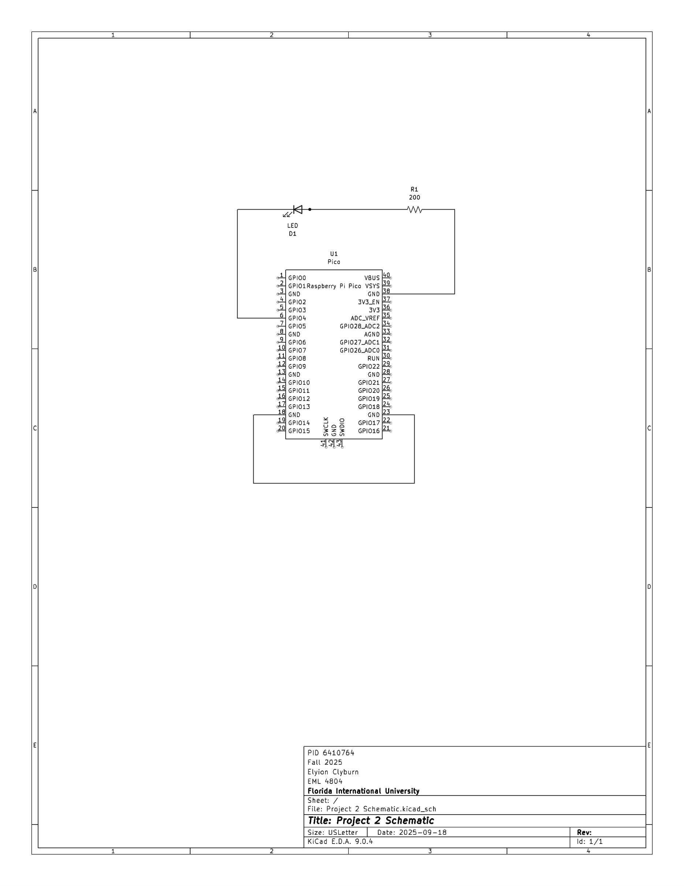

# EML 4804 Intro to Mechatronics

## Table of Contents

1. [Project 1: Basic Circuit](#project_1)
2. [Project 2: Introduction to Raspberry Pico Pi](#project_2)
3. [Project 3: Raspberry Pico Pi and LCD1602](#project_3)
4. [Project 4: Functions, Loops](#project_4)

<a id="project_1">
## Project 1: Basic Circuit

### Introduction
The purpose of this projectis to learn how to build simple circuits by using the Raspberry PICO board, power supplies and simplpe electronic components to test an idea created from a model.

### Materials List
- Breadboard
- Raspberry PICO board
- Power module and LiPo battery in the holder or USB cable
- Red LED
- resistor 220 Ohm
- resistor 10 kOhm
- resistor 100 kOhm
- tactile switch
- 4 x 10 mF electrolytic capacitors
- Breadboard wires

### Circuit image

### Video Link
[Project 1 Video](https://youtu.be/jmQDxbgHbuQ)

### KiCAD Diagram

### Conclusions
**What have you learned?** From this assignment, I learned how to create and read electrical schematics (better), and how to carefully create a simple circuit from mentioned schematics.

**How difficult was this assignment?** This assignment was not too difficult, maybe 4/10. I say this because I took a while to understand fully the flow of electricity in the circuit I was building compared to the schematic because the application looks a bit more confusing than the diagram.

**How did you overcome challenges?** To overcome my lack of complete understanding of the application to the circuit diagram, I rearranged the components on my breadboard and then cross-checked with the example video and my diagram to make sure the electricity was still flowing where I wanted it to.

### References
Home Project #1 Basic Circuit Canvas Rubric
[Mechatronics with PICO | KiCAD basics](https://www.youtube.com/watch?v=gl4FkAs9G-A&t=805s)

<a id="project_2">
## Project 2: Introduction to Raspberry PICO Pi

### Introduction
The purpose of this project is to understand basic coding and implementing them into the Raspberry Pi PICO board and components of the circuit. The basis of all mechatronics is rooted in programming, electronic components, and mechanical components. While the first lab was an introduction to basic circuits, covering the theory required to safely handle electricity without starting an electric fire, this lab was used as a way to familiarize students with coding the components of circuits.

### Materials List
- Breadboard
- Raspberry PICO board
- Blue LED
- resistor 220 Ohm
- USB-A to micro-USB cable
- Breadboard wires

### Circuit image

### Video Link
[Project 2 Video](https://www.youtube.com/shorts/YENpWfqNBI8)

### KiCAD Diagram

### Conclusions
**What have you learned?** From this assignment, I learned how to use a Python program to code a circuit

**How difficult was this assignment?** This assignment was not difficult at all, just tedious if anything. Creating the circuit was easy because it’s what we did for the first lab, writing the code was just tedious because I had to define five numbers by turning the light on and off and on an off repetitively.

**How did you overcome challenges?** With the tediousness of the assignment being the only “challenge” I experienced, the way I overcame it was by copy-pasting the function of one number to the function of each one and changed the values of the timer.

### References
Home Project #2 Introduction to RB PICO Canvas Rubric

<a id="project_2">
## Project 2: Introduction to Raspberry PICO Pi

### Introduction
The purpose of this project is to understand basic coding and implementing them into the Raspberry Pi PICO board and components of the circuit. The basis of all mechatronics is rooted in programming, electronic components, and mechanical components. While the first lab was an introduction to basic circuits, covering the theory required to safely handle electricity without starting an electric fire, this lab was used as a way to familiarize students with coding the components of circuits.

### Materials List
- Breadboard
- Raspberry PICO board
- Blue LED
- resistor 220 Ohm
- USB-A to micro-USB cable
- Breadboard wires

### Circuit image

### Video Link
[Project 2 Video](https://www.youtube.com/shorts/YENpWfqNBI8)

### KiCAD Diagram

### Conclusions
**What have you learned?** From this assignment, I learned how to use a Python program to code a circuit

**How difficult was this assignment?** This assignment was not difficult at all, just tedious if anything. Creating the circuit was easy because it’s what we did for the first lab, writing the code was just tedious because I had to define five numbers by turning the light on and off and on an off repetitively.

**How did you overcome challenges?** With the tediousness of the assignment being the only “challenge” I experienced, the way I overcame it was by copy-pasting the function of one number to the function of each one and changed the values of the timer.

### References
Home Project #2 Introduction to RB PICO Canvas Rubric
