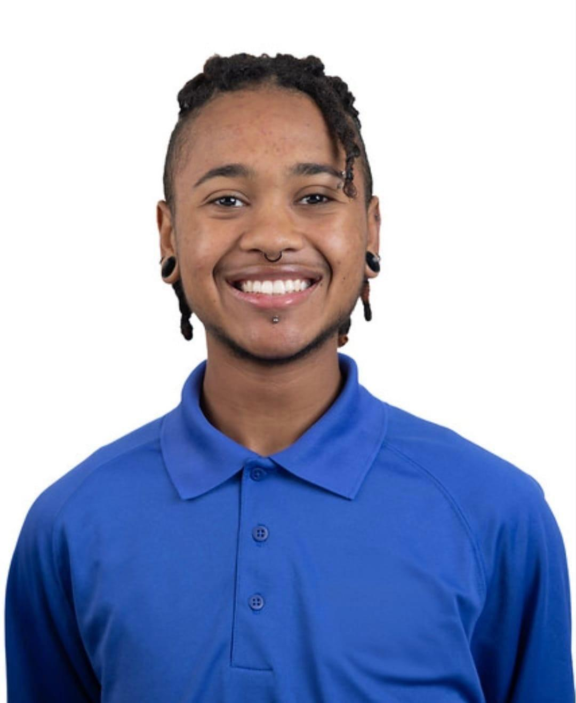

# Welcome to my page!

  

Hey! I am Elyion Clyburn, pronounced eh-lie-yawn, and I am graduating from Florida International University with my Bachelor of Science in mechanical engineering in December of 2026. I will then pursue a Master of Science in Mechanical Engineering, on a Robotics track. Robotics, and mechatronics as a whole, have been an interest of mine for aslong as I can remember. On this page, you will find a collection of projects I have completed throughout my studies. They range as from various CAD models, to simple breadboard circuits, to my senior design project.

Find me on [**Linked In**](www.linkedin.com/in/elyion-clyburn-39a026286) and [**Handshake**](https://fiu.joinhandshake.com/profiles/6hhb7p).

<"# Computer-Aided Design Models
These files contain a plethora of designs, starting from my Computer-Aided Design course EML 1533 and continue throughout my time in my undergraduate studies at FIU." style="max-width: 200px">

# Introduction to Mechatronics
Introduction to Mechatronics, EML 4804, was one of the most fun classes I have taken during my time in my undergraduate studies. [**Here**](https://github.com/martyrock04/Elyion_Clyburn_Portfolio/tree/main/Mechatronics), you will find a collection of projects constructed throughout the course, as well as other mechatronics projects I made on my own time.

# Senior Design Project
To bring our academic journey to an end, engineering majors are required to complete a capstone project; to bring together all the skills we have accumulated over the years. Our website, which is constantly being updated, is linked [**here**](https://sea-gliders.pages.dev/). It contains the following, and much more:
- Project overview
- Member roles
- Metrics
- Market and patent research
- Decision matrices
- Electrical architecture
- Manufacturing processes
- Testing methodologies
- Risks
- Resources

